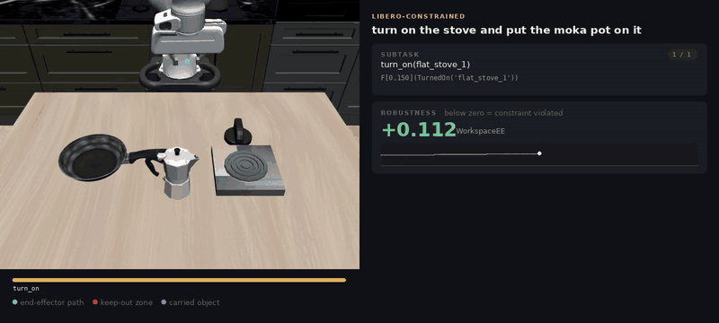
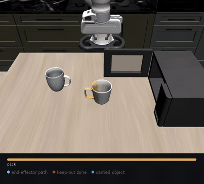

# STeP

<table>
  <tr>
    <td align="center"></td>
    <td align="center"></td>
  </tr>
  <tr>
    <td align="center"><em>"turn on the stove and put the moka pot on it"</em></td>
    <td align="center"><em>"put the yellow and white mug in the microwave and close it"</em></td>
  </tr>
</table>

STeP runs language-instructed manipulation tasks in LIBERO with a two-level
system:

- **System 2** (`step/system_two/`): a VLM reads the instruction and a scene
  image and writes a signal temporal logic (STL) specification of the task.
- **System 1** (`step/system_one/`): a library of manipulation skills (pick,
  place, transport, open, close, turn on) executes it, planning with OMPL and
  tracking with MPC, while monitoring the specification's robustness.

## How a run works

1. Load `configs/libero_template.json` and reset the LIBERO task once to build
   a `scene_context`: the objects, fixtures (drawers, cabinet tops, stove,
   table) and precomputed scene facts the planner needs.
2. Render the agentview image (unless `--image` is given).
3. System 2 writes the plan. In the default `--stl-mode stl_spec`, the VLM
   writes **one STL formula for the whole task**, and
   `step/system_two/stl_plan.py:decompose()` derives the ordered subtasks
   (skill, parameters, per-subtask formula) from it deterministically. See
   `STL_DECOMPOSITION_PLAN.md`.
4. Validate the plan, then execute each subtask with System 1.
5. If execution fails, recall System 2 against the current, unreset scene and
   retry (`--max-pipeline-retries`, default 3).

Every run writes the scene context, prompt, raw and decomposed plans, an
`execution_summary.json`, and optionally a video to `--outdir`.

## Installation

STeP's own [pyproject.toml](pyproject.toml) only declares `openai` -- all the
heavy lifting (LIBERO, robosuite, MuJoCo, contact-graspnet, OMPL) comes from
a sibling [cap-x](https://github.com/capgym/cap-x) checkout that every
`scripts/run_libero_*.py` adds to `sys.path` at runtime. Concretely, that
means:

- STeP and cap-x are expected to live next to each other, e.g.
  `~/Documents/step/{STeP,cap-x}`.
- Everything LIBERO-related runs with cap-x's `.venv-libero` (a uv venv,
  Python 3.12) active -- not a venv inside STeP itself.

Requires a Linux machine with a CUDA-capable GPU (for LIBERO/MuJoCo
rendering and contact-graspnet) and Python 3.12.

### Quick setup

```bash
cd STeP
bash scripts/setup_env.sh
```

This clones cap-x as a sibling of STeP if it isn't already there, creates
its `.venv-libero` uv venv with the `libero` + `contactgraspnet` extras,
bridges in OMPL (see below), and writes `scripts/env.sh` with
`CONTACT_GRASPNET_CHECKPOINT_DIR` pointed at the checkpoint bundled in
cap-x's `contact_graspnet_pytorch` submodule -- `configs/libero_template.json`
ships that setting blank on purpose, and without it every pick silently
falls back to a heuristic grasp generator instead of the real model. Pass
`--cap-x-root /path/to/cap-x` if you already have a checkout elsewhere.
Re-running is safe; each step skips if already done.

**OMPL** has no prebuilt PyPI wheel, so `uv sync` alone can't get you its
Python bindings. The script bridges it in from a conda-forge build instead:
it creates (or reuses) a small `ompl_bridge` conda env just to fetch
prebuilt binaries, then copies the `ompl` package plus its own
libstdc++/libgcc_s/boost into `.venv-libero` so it never touches your
system's libstdc++. This needs `conda` on `PATH` once; nothing conda-related
is required afterwards to run STeP. If `conda` isn't available, you'll need
to get OMPL's Python bindings into `.venv-libero` some other way (e.g.
building it from source against that venv's Python).

### Before running anything

```bash
source ../cap-x/.venv-libero/bin/activate
source scripts/env.sh
export OPENAI_API_KEY=...
```

Sanity check:

```bash
python -c "from libero.benchmark import get_benchmark; print(get_benchmark('libero_spatial')().n_tasks)"
```

Should print `10`.

## Repository layout

| path | contents |
|---|---|
| `step/libero_runner.py` | single-task entry point (`scripts/run_libero_step.py`) |
| `step/libero_suite_runner.py` | runs a whole suite, one subprocess per rollout (`scripts/run_libero_suite.py`) |
| `step/libero_pro_eval.py` | LIBERO-Pro evaluation grid (`scripts/run_libero_pro_eval.py`) |
| `step/system_two/` | VLM planner, prompts, plan validation and STL decomposition |
| `step/system_one/` | executor, LIBERO env, scene discovery, STL monitoring |
| `step/system_one/motion/` | shared motion layer: `SceneQuery` (MuJoCo scene access), collision checking, IK, OMPL planner, MPC, articulation discovery |
| `step/system_one/skills/` | one subdirectory per skill (planning skill + LIBERO adapter); `registry.py` maps skill names to executor methods |
| `step/perception/` | vision-only perception pipeline (see below) |
| `schemas/` | `stl_global_plan_schema.json` (one global formula, default) and `stl_plan_schema.json` (per-subtask plan) |
| `configs/` | `libero_template.json` (default scene/runtime config), `libero_safety.json` (safety-prompt variants), experiment scenes |
| `benchmarks/libero_constrained/` | the LIBERO-Constrained benchmark (see its own README) |
| `examples/` | prebuilt plans for smoke tests |
| `tests/` | pytest suite; tests needing LIBERO skip when it isn't installed |

## Skills

| skill | does |
|---|---|
| `pick` | grasp an object (Contact-GraspNet candidates, heuristic fallback) and lift it |
| `transport` | carry the held object over a goal region |
| `place` | set the held object on or into a goal (`place_surface: top / inside`) |
| `open` | grasp a drawer handle and pull it open |
| `close` | push a drawer or microwave door shut |
| `turn_on` | grasp and rotate a stove knob |

All of these run on the OMPL + MPC motion backend
(`platform.libero.motion_backend: "ompl_mpc"`). The schema also allows
`pour`, which only has a legacy-backend implementation. To add a skill, see
`step/system_one/skills/__init__.py`.

## Plan format

Formulas are JSON trees:

```json
{
  "type": "eventually",
  "interval": [0, 90],
  "child": {"type": "predicate", "name": "Grasped", "args": ["bowl"]}
}
```

Node types are `true`, `predicate`, `not`, `and`, `implies`, `always`,
`eventually` and `until`. Predicates include `PreGrasp`, `Grasped`,
`OverGoal`, `Placed`, `Released`, `Safe`, `Upright`, `CarryHigh`,
`InRegion`, `Opened`, `Closed` and `TurnedOn`; their arguments are entity
names from the scene context.

`--stl-mode` picks what System 2 writes:

- `stl_spec` (default): one formula for the whole task, plus per-object hints
  (`grasp_target`, `grasp_offset_xyz`, `place_surface`). Decomposed into
  subtasks after the fact.
- `skill_graph`: the VLM writes the subtask list directly, each with
  `subtask_id`, `skill`, `description`, `params` and its own `formula`.
- `no_stl`: the same skill list without any specification terms, as a
  baseline.

`Grasped` takes an optional second argument, the object's height in metres
(`Grasped(can, 0.09)`), so System 1 grasps tall objects near mid-height
instead of at their base. Rim-grasp objects (bowls, mugs) use
`grasp_offset_xyz` instead.

## Running

Validate and print a prebuilt plan without calling the model:

```bash
python scripts/run_libero_step.py --compiled-plan examples/pick_place_direct_stl_plan.json --dry-run
```

Plan and execute one task (drop `--dry-run` to execute):

```bash
python scripts/run_libero_step.py --suite libero_spatial --task-id 0 --init-state-id 0 \
  --outdir outputs/spatial0 --save-video outputs/spatial0/rollout.mp4 --dry-run
```

Useful options: `--prompt` (override the instruction), `--model` (VLM, default
`$OPENAI_MODEL` or `gpt-5.4`), `--max-pipeline-retries`, `--render`.

### Suites

```bash
python scripts/run_libero_suite.py --suite libero_spatial            # first init state of every task
python scripts/run_libero_suite.py --suite libero_goal --all-states  # or --max-states N / --state-ids ...
```

Each rollout runs in its own subprocess (`--rollout-timeout`, default 300 s).
Results go to `--outdir` (default `outputs/<suite>_<timestamp>/`), one
directory per rollout at `<suite>__taskXX/state_YYY/`, with the aggregate in
`results_summary.json`. `--skip-existing` resumes an interrupted run.

### LIBERO-Pro

`--perturbation {swap,task,object,lan,random}` runs LIBERO-Pro's perturbed
variant of a suite (on both runners). The full grid matching Cap-X's protocol:

```bash
python scripts/run_libero_pro_eval.py   # spatial/object/goal x {swap, task}; outputs/libero_pro_<timestamp>/
```

### LIBERO-Constrained

Instructions with a requirement beyond the goal: a keep-out zone, an ordering,
a deadline. The task set and scoring are in
`benchmarks/libero_constrained/`. Run one task from the frozen manifest:

```bash
python scripts/run_libero_step.py --benchmark-task libero_10/0/S-zone
```

`--avoid-region <entity>` / `--zone-center-xy X Y` declare a keep-out zone
directly; `--place-obstacle-in-path` moves the obstacle onto the transport
path; `--no-enforce-keepout` scores the zone without planning around it (the
"STL off" ablation).

## Perception: privileged vs vision

`--perception` (on the single-task and suite runners) picks how STeP learns
what is in the scene:

- `privileged` (default): object names, poses and collision geometry come from
  the simulator.
- `vision`: only the agentview + wrist RGB-D cameras (with their calibration)
  and the robot's own joint state. Nothing about objects is read from the sim.

```bash
python scripts/run_libero_step.py --suite libero_goal --task-id 0 --perception vision
```

What vision mode does (`step/perception/`):

1. **Find and name objects.** The VLM proposes generic categories, SAM3
   segments them in both cameras, and every instance is drawn as a numbered
   mark, with one number per object across both views. The VLM identifies
   each mark (with zoomed crops for small objects), then a second call maps the
   instruction's objects to marks. Depth-measured stacking ("rests on mark 4")
   is given to the VLM and to System 2.
2. **Reconstruct geometry.** Masks are lifted to 3D with depth, cleaned, and
   turned into a box decomposition of each object's top-surface heightmap
   (hollow bowls stay hollow). The table is a RANSAC plane; drawers are a
   handle plus the cabinet front's plane normal; knobs are a hinge about the
   normal of the surface they sit on.
3. **Plan against a perceived model.** A MuJoCo model with the real robot and
   only the perceived scene is what `SceneQuery.from_robosuite_sim` returns, so
   every skill, OMPL, MPC and Contact-GraspNet run unchanged on perceived data.
4. **Track between keyframes.** Objects are re-perceived at each subtask start
   and after every release. While held, an object moves with the gripper;
   a grasped drawer or knob moves with the hand. Thin grasps (bowl rims) are
   confirmed by lifting and checking the cameras.

Every vision run's `execution_summary.json` carries a `privileged_access_audit`.
Its `disallowed` map must be empty; the only allowed reads are LIBERO's own
success check (scoring) and experiment scene construction. Set
`STEP_PERCEPTION_STRICT=1` to make any disallowed read raise.

Measuring it:

```bash
# Perception accuracy vs ground truth (ground truth is read only for scoring).
python scripts/eval_perception_accuracy.py --suite libero_goal --task-ids 0 1 2 --outdir outputs/acc
python scripts/eval_perception_accuracy.py --outdir outputs/acc --report-grounding
# Same tasks in both modes, side by side.
scripts/compare_perception_modes.sh outputs/compare "libero_goal 0" "libero_goal 7"
```

Requirements and limits:

- SAM3 weights (gated on HuggingFace) and `OPENAI_API_KEY` for the VLM. SAM3
  runs in-process (~6 GB GPU at peak); set `STEP_SAM3_URL` to use cap-x's
  `launch_sam3_server` instead. Run one vision rollout at a time on a 12 GB
  GPU / 16 GB RAM machine.

